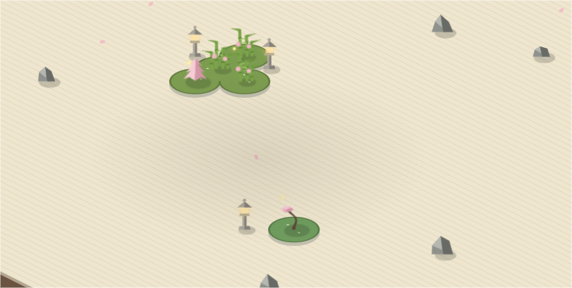

# Garden Zen

> Your vault as a quiet zen garden. Notes are plants, folders are islands, and raked sand flows between them.

Garden Zen is a calm, isometric map of your notes. Nothing to configure before it works: open it and every note you have already written is planted, sized by how much you wrote and how connected it is. Come back next week and the garden has changed with you.

## Reading the garden

**Every note is a plant.** It grows through five stages as it gains words and links. Backlinks count double: a note other notes rely on is a note with deep roots.

| Stage | What you see |
| --- | --- |
| Seed | A tuft of grass |
| Sprout | Young bamboo stalks |
| Plant | A small tree |
| Shrub | A fuller tree |
| Tree | A tall tree, round, pine or bonsai |

**Every plant shows its season.**

- **In bloom:** edited in the last 7 days. Sakura petals open.
- **Healthy:** touched now and then.
- **Wilted:** untouched for 90 days. It turns into a mossy stone. Edit the note and it grows back.

**Every folder is an island.** Islands are drawn as moss planets in the sand:

- The note named like its folder (`Recipes/Recipes.md`) stands in the center, and the rest of the folder grows in rings around it.
- Islands full of grown notes spread out with clearings between plants. Young islands stay small and dense.
- Each island has its own irregular outline, so no two look alike.

**Links are stepping stones.** Hover a plant and a path of stones leads to every note it links to.

**Moons and planets (optional).** Some folders hold many small notes: logs, archives, meeting notes. List them under *Moon folders* and their notes orbit the parent island as small pebbles instead of crowding it. List folders under *Planet folders* and each note inside becomes an island of its own, which suits areas or big topics.

## Using it

Open it from the sprout icon in the ribbon or from the command palette:

- **Open garden**
- **Go to a note in the garden:** fuzzy search, then the camera flies to the note.
- **Show the active note in the garden**
- **Watch the garden grow:** a timelapse that plants your notes in the order you created them.

Click a plant to open its note. Drag to pan and scroll to zoom. Click an island name to zoom into it, and right-click a plant for more options.

## Shaping your garden

Everything below lives in the settings tab and the side panel of the garden view.

| Group | Settings |
| --- | --- |
| Notes | Excluded folders, moon folders, collapse repeated moons, planet folders |
| Islands | Group by (type, folder, subfolder, tag, or a single island), size, spacing between islands, moon orbit, roughness of the outlines, sand furrows, island names |
| Decoration | A slider per piece: rocks and koi ponds in the sand (per 20 notes), stone lanterns, pagodas and torii gates on each shore (per island). 0 hides a piece |
| Plants | Tree style, growth rate, bloom and wilt days, plant size, labels |
| Motion | Swaying, falling petals, clouds, fireflies, lantern flicker, smooth camera |
| Colors | Palette presets, or pick your own sand, moss, canopy, blossom and text colors |

### Per-note frontmatter

| Key | Effect |
| --- | --- |
| `island: Name` | Plant the note on that island, whatever its folder |
| `garden: false` | Keep the note out of the garden |
| `stage: tree` | Force a stage: `seed`, `sprout`, `plant`, `shrub` or `tree` |
| `plant: pine` | Pick its tree: `round`, `pine` or `bonsai` |

## Install

**From Obsidian:** Settings → Community plugins → Browse → search **Garden Zen**.

**Before it is listed:** install [BRAT](https://github.com/TfTHacker/obsidian42-brat) and add `racconrad/garden-zen`.

**Manually:** download `main.js`, `manifest.json` and `styles.css` from the [latest release](https://github.com/racconrad/garden-zen/releases/latest) into `<your vault>/.obsidian/plugins/garden-zen/`, then enable Garden Zen in Community plugins.

Works on desktop and mobile. Garden Zen only reads your notes and never changes them.

## License

MIT © racconrad
